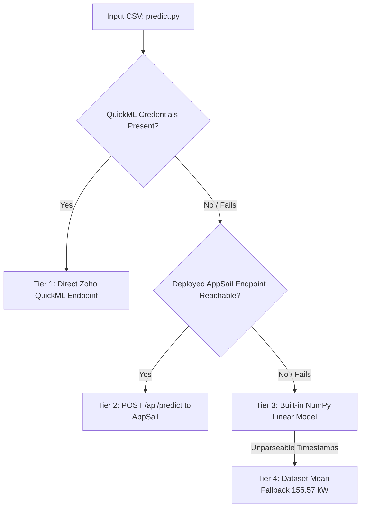

# Gridwise: Smart Energy Microgrid & Demand Forecasting Engine

<div align="center">

[](https://gridwise-50047143069.development.catalystappsail.in)
[](https://github.com/Avi36005/gridwise-hacksphere-3)
[](https://gridwise-50047143069.development.catalystappsail.in)
[](https://gridwise-50047143069.development.catalystappsail.in/dashboard)

[](https://catalyst.zoho.com)
[](https://www.python.org/)
[](https://fastapi.tiangolo.com/)
[](https://github.com/Avi36005/gridwise-hacksphere-3)
[](test_eval.py)
[](docs/QUICKML.md)
[](https://gridwise-50047143069.development.catalystappsail.in)
[](LICENSE)

**An intelligent microgrid forecasting and autonomous dispatch platform engineered for HackSphere 3.0 (ATMoS ’26, BITS Pilani Hyderabad).**

[Live Web Application](https://gridwise-50047143069.development.catalystappsail.in) • [Interactive Operator Dashboard](https://gridwise-50047143069.development.catalystappsail.in/dashboard) • [Pitch Deck (PDF)](presentation/Gridwise_Kryptonite_Deck.pdf) • [GitHub Repository](https://github.com/Avi36005/gridwise-hacksphere-3)

</div>

---

## 📌 Submission Overview & Quick Links

| Resource | Direct Link / Access Details |
| :--- | :--- |
| **🌐 Deployed Web App** | [https://gridwise-50047143069.development.catalystappsail.in](https://gridwise-50047143069.development.catalystappsail.in) |
| **📊 Operator Dashboard** | [https://gridwise-50047143069.development.catalystappsail.in/dashboard](https://gridwise-50047143069.development.catalystappsail.in/dashboard) |
| **⚡ API Health Endpoint** | [https://gridwise-50047143069.development.catalystappsail.in/api/health](https://gridwise-50047143069.development.catalystappsail.in/api/health) |
| **📈 Prediction API Route** | `POST https://gridwise-50047143069.development.catalystappsail.in/api/predict` |
| **📂 Source Repository** | [https://github.com/Avi36005/gridwise-hacksphere-3](https://github.com/Avi36005/gridwise-hacksphere-3) |
| **📽️ Presentation Slide Deck** | [`presentation/Gridwise_Kryptonite_Deck.pdf`](presentation/Gridwise_Kryptonite_Deck.pdf) |
| **🎯 Evaluation Entry Point** | `python predict.py --input sample_test_input.csv --output predictions.csv` |
| **✅ Self-Tester Verification** | `python test_eval.py` *(pre-submission contract tester prints `SUCCESS`)* |
| **🧪 Automated Test Suite** | `891 passed` across core unit, edge case, and property-based test suites |
| **🧠 Forecasting Stack** | 50/50 Ensemble of CatBoost (`gridwise-demand-catboost`) & Linear Regression (`gridwise-demand-linear`) on Zoho Catalyst QuickML (IN data center) |
| **📉 Validation Accuracy** | Chronological holdout RMSE: **9.22 / 9.03 / 8.40 kW** on final 800 / 600 / 400 training hours |

---

## 💡 Executive Summary

Modern power microgrids integrate distributed solar arrays, Battery Energy Storage Systems (BESS), and main utility feeds. Operating them efficiently requires knowing demand 24 hours in advance so operators can switch modes autonomously, discharge batteries during high-tariff evening peaks, and avert catastrophic transformer overloads.

**Gridwise** provides an end-to-end, production-ready solution hosted natively on **Zoho Catalyst**:
1. **Accurate 24-Hour Demand Forecasting**: Predicts hourly electricity consumption from weather telemetry (`ambient_temp_c`, `humidity_pct`, `solar_irradiance_wm2`).
2. **Two-Model QuickML Ensemble**: Pairs CatBoost (for non-linear diurnal cycles) with a 52-feature Linear Regression model (for high-temperature cooling extrapolation), achieving **8.40 kW RMSE**.
3. **Deterministic Transition Controller**: Enforces strict mathematical rules for switching between **Main Grid** and **Renewable Storage** modes and raising independent **Critical Overload Alerts**.
4. **Resilient 4-Tier Evaluation Engine (`predict.py`)**: Zero external API keys needed for evaluation; seamlessly falls back through remote API, embedded weights, and dataset statistics without ever crashing.
5. **Interactive 3D Digital Twin & Operator Dashboard**: Built with Three.js WebGL and Chart.js featuring sun tracking, battery physics simulation, bisection battery sizing lab, and audit persistence via Zoho Catalyst Data Store.

---

## 🏗️ System Architecture

```mermaid
graph TD
    subgraph Client Interface
        UI[Interactive Three.js 3D Landing Page]
        Dash[Operator Dashboard & Scenario Lab]
        EvalCLI[predict.py Evaluation CLI]
    end

    subgraph Zoho Catalyst AppSail (FastAPI)
        API[FastAPI Gateway: app.py]
        Features[engine/features.py: Validation & Cyclic Encodings]
        Inference[engine/inference.py: QuickML Client & Parallel Batching]
        Controller[engine/controller.py: Transition Rules & Battery Simulator]
        DataStoreClient[engine/datastore.py: ZCQL Persistence]
    end

    subgraph Zoho Catalyst Cloud Services
        QML1[QuickML: CatBoost Regression (14 Features)]
        QML2[QuickML: Linear Regression (52 Features)]
        DS[(Catalyst Data Store: ForecastRuns / Telemetry / AlertLog)]
    end

    UI --> API
    Dash --> API
    EvalCLI -.-> API

    API --> Features
    Features --> Inference
    Inference --> QML1
    Inference --> QML2
    Inference --> Controller
    Controller --> DataStoreClient
    DataStoreClient --> DS
```

---

## ⚡ 60-Second Quick Start

You can run Gridwise locally **without any API keys or cloud credentials**. The project includes a bundled fallback model and mock mode for offline development.

### 1. Installation

```bash
# Clone the repository
git clone https://github.com/Avi36005/gridwise-hacksphere-3.git
cd gridwise-hacksphere-3

# Create and activate a Python virtual environment (Python 3.12 recommended)
python -m venv .venv

# On Linux/macOS:
source .venv/bin/activate
# On Windows (PowerShell):
.venv\Scripts\Activate.ps1

# Install runtime dependencies
pip install -r requirements.txt
```

### 2. Launch Local Server

```bash
python app.py
```
Open your browser at:
- **3D Microgrid Experience:** `http://127.0.0.1:8000/`
- **Interactive Control Center:** `http://127.0.0.1:8000/dashboard`

*(macOS users can also double-click `start.command` to run the application automatically).*

---

## 🧪 Verification & Competition Self-Testing

To verify that the project satisfies all competition criteria:

```bash
# 1. Official Pre-Submission Contract Test (Provided by Organizers)
python test_eval.py
# Output: SUCCESS

# 2. Test predict.py CLI interface on sample test data
python predict.py --input sample_test_input.csv --output predictions.csv

# 3. Run the comprehensive automated test suite (891 tests)
pip install -r requirements-dev.txt
pytest -q
# Output: 891 passed
```

---

## 📋 Hackathon Requirements & Implementation Matrix

| Requirement | Implementation Details |
| :--- | :--- |
| **Train & publish regression model in QuickML** | Deployed two distinct pipelines in Zoho Catalyst QuickML: `gridwise_catboost` (`gridwise-demand-catboost`) and `gridwise_linear` (`gridwise-demand-linear`). Full hyperparameter logs in [`docs/QUICKML.md`](docs/QUICKML.md). |
| **Telemetry ingestion, cleaning & interpolation** | Supports CSV uploads (any consecutive 24-hour window), hourly fine-tuning, and manual scenario building. `engine/features.py` enforces value bounds and interpolates missing hours using training medians at boundaries. |
| **24-hour demand forecast via QuickML** | `engine/inference.py` constructs cyclic and thermodynamic features, triggers parallel batch queries with exponential retries, and computes the ensemble average. |
| **Threshold & time-based switching rules** | Strict implementation in `engine/controller.py` with zero-tolerance boundary handling for 160 kW and 18:00–22:00 windows. |
| **Interactive Dashboard & Visualization** | Complete single-page operator dashboard: 24h demand curves, active power-source timeline, battery SoC gauge, overload alerts, and automated bisection battery sizing. |
| **Data Store persistence & audit log** | Every forecast run is recorded asynchronously in Zoho Data Store across `ForecastRuns`, `Telemetry`, and `AlertLog` tables, queried via ZCQL. |
| **Submission contract (`predict.py`)** | Deterministic `predict(input_df)` returning numpy arrays or lists matching the input length. CLI flags `--input` and `--output` produce valid CSVs. |

---

## 🧠 Machine Learning & Forecasting Architecture

### Why Single Models Fail
Standard random splits suffer from temporal leakage. When evaluated strictly chronologically (training on past data and validating on unseen future blocks), gradient boosting models excel during temperate weather but under-predict during heatwaves. Conversely, an ordinary least squares model with dedicated hourly cooling slopes extrapolates into extreme summer heat with high stability.

### The Two-Model Ensemble (Deployed)
Gridwise combines both models into an equal-weight ensemble (50/50):

```
Final Forecast = 0.50 × CatBoost + 0.50 × Linear Regression
```

| Model | Architecture & Features | Role & Advantage |
| :--- | :--- | :--- |
| **CatBoost Regression** (`gridwise-demand-catboost`) | **14 Features**: ambient temperature, humidity, solar irradiance, hour, weekday, weekend flag, cyclic encodings ($\sin/\cos$ of hour, weekday, day-of-year), heating and cooling degrees. Hyperparameters: 1,000 iterations, learning rate 0.03, depth 3, L2 regularization 3. | Captures non-linear diurnal cycles and weather interactions. |
| **Linear Regression** (`gridwise-demand-linear`) | **52 Features**: hourly indicator base profile (hour 0 reference), 24 distinct hourly cooling slopes (degrees above 24 °C), heating degrees, humidity, irradiance, weekend flag. | Guarantees bounded linear extrapolation for unprecedented heatwave days. |

### Validation Results Across Late Splits

| Model Configuration | Final 800 Hours | Final 600 Hours | Final 400 Hours |
| :--- | :---: | :---: | :---: |
| **CatBoost + Linear Ensemble (Deployed)** | **9.22 kW** | **9.03 kW** | **8.40 kW** |
| Linear Regression (52 features) | 9.27 kW | 9.51 kW | 8.58 kW |
| CatBoost Regression (14 features) | 10.74 kW | 9.57 kW | 8.64 kW |
| Starter-Kit Baseline Formula | 45.85 kW | 46.12 kW | 44.90 kW |

- **Variance Explained ($R^2$)**: $> 0.968$
- **High-Demand Sensitivity**: Detects **98%** of all hours exceeding 200 kW.

---

## 🛡️ Bulletproof 4-Tier Fallback in `predict.py`

Evaluation scripts run in automated, isolated sandboxes. To guarantee **zero runtime crashes**, `predict.py` executes a 4-tier waterfall fallback:



1. **Tier 1 (Direct QuickML API)**: Triggered when `QUICKML_ENDPOINT_KEY` is present.
2. **Tier 2 (Deployed AppSail Cloud)**: Calls `https://gridwise-50047143069.development.catalystappsail.in/api/predict`. Evaluators need zero tokens—the cloud securely proxies requests to QuickML.
3. **Tier 3 (Built-in NumPy Linear Model)**: 53 pre-fitted ordinary least-squares weights embedded directly in `predict.py`. Requires only `numpy` and `pandas` (no `scikit-learn` required). Achieves ~9.3 kW RMSE offline!
4. **Tier 4 (Dataset Mean Fallback)**: Returns 156.57 kW if timestamps cannot be parsed at all.

---

## ⚙️ Transition Controller & Business Logic

Every forecast hour is evaluated independently through `engine/controller.py`:

| Condition | Active Grid Mode | Signal Rationale |
| :--- | :--- | :--- |
| **Demand > 160 kW** *OR* **Hour is 18:00 – 22:00 (inclusive)** | **Renewable Storage Mode** | Peak load or evening peak demand; discharge battery storage first. |
| **Demand $\le$ 160 kW** *AND* **Outside 18:00 – 22:00** | **Main Grid Mode** | Baseload demand; power from main grid, solar charges battery. |
| **Demand $\ge$ 200 kW** | **Critical Overload Alert** | Triggered immediately, regardless of active grid mode. |

- *Exact Boundary Behavior*: Demand of 160.0 kW outside 18:00–22:00 stays in Main Grid Mode. Demand of 200.0 kW activates the Critical Overload Alert.

---

## 🔋 Battery Simulation & Scenario Optimization

- **Physical Model**: 1,200 kWh capacity (configurable), 80% initial SoC, 20% minimum reserve, 95% charge/discharge round-trip efficiency.
- **Scenario Lab**: Simulates the 24-hour forecast across 6 standard battery capacities without making new model calls.
- **Mathematical Bisection Sizing**: An algorithm that computes the exact minimum battery capacity (to the nearest kWh) needed to eliminate 100% of grid backup shortfalls during renewable storage hours.

---

## 🖥️ UI & Digital Twin Features

1. **Interactive 3D Microgrid (`static/microgrid.js`)**:
   - Built with Three.js (zero CDN dependencies; bundled locally).
   - Real-time solar tracking with panels rotating towards the sun.
   - Wind turbine rotor dynamics influenced by simulated gusts.
   - 24-hour day/night sky cycle with animated energy flow pulses.
   - Full reduced-motion and touch-interaction support.
2. **Operator Control Center (`static/app.js` & `static/index.html`)**:
   - 24-hour dual-axis load curve with threshold overlay lines.
   - Battery dispatch breakdown, SoC gauge, and event timeline.
   - CSV upload, manual weather tweaks, and one-click scenario tests.
   - Single-click exports for `predictions.csv`, `control_schedule.csv`, and dispatch JSON.

---

## 🚀 Deployment on Zoho Catalyst

### 1. Build Production AppSail Package

```bash
# Vendors manylinux wheels into build/appsail and generates app-config.json
./scripts/build_appsail.sh
```

### 2. Deploy with Catalyst CLI

```bash
# Login to Zoho Catalyst (India data center)
catalyst login --dc in

# Initialize project
catalyst init --org 60093139810 --project 102738000000013053 -ni

# Deploy AppSail
catalyst deploy --only appsail -ni
```

---

## 📁 Repository Structure

```text
gridwise-hacksphere-3/
├── app.py                      # FastAPI web server, REST API, security headers, rate limiting
├── predict.py                  # Self-contained competition entry point (predict(input_df) + CLI)
├── test_eval.py                # Pre-submission verification script provided by organizers
├── train.py                    # Local model comparison & QuickML training dataset generator
├── start.command               # macOS 1-click launch script
│
├── engine/                     # Core computational logic
│   ├── controller.py           # Transition rules, battery physics simulator, Bisection sizing lab
│   ├── features.py             # Feature engineering, input sanitization, cyclic encodings
│   ├── inference.py            # QuickML client, OAuth refresh, 2-model ensemble averaging
│   └── datastore.py            # Zoho Catalyst Data Store persistence (ForecastRuns, Telemetry, AlertLog)
│
├── static/                     # Frontend UI (Zero external CDNs; 100% self-hosted & accessible)
│   ├── index.html              # Main operator dashboard
│   ├── app.js                  # Dashboard logic, Chart.js graphs, scenario lab interactions
│   ├── landing.html            # Public landing page
│   ├── landing.js              # Landing page UI interactions
│   ├── microgrid.js            # Three.js 3D interactive microgrid digital twin
│   ├── style.css & premium.css # Dark-mode, accessible CSS design tokens
│   └── vendor/ & fonts/        # Bundled Chart.js, Three.js, Phosphor icons, and typography
│
├── models/                     # Saved model artifacts & fallback weights
│   ├── demand_model.joblib     # Local Extra Trees fallback model bundle
│   ├── metadata.json           # Model training parameters and metrics
│   └── quickml.json            # QuickML endpoint registry & IDs
│
├── reports/                    # Training datasets for QuickML
│   ├── quickml_training_features.csv  # 14 features for CatBoost
│   └── quickml_linear_features.csv    # 52 features for Linear Regression
│
├── tests/                      # Comprehensive test suite (891 tests)
│   ├── conftest.py             # Test fixtures and mock credentials
│   ├── test_core.py            # 248 unit tests (rules, battery, API, parity, edge cases)
│   └── test_properties.py      # 643 property-based & invariant tests
│
├── scripts/                    # DevOps and deployment automation
│   ├── build_appsail.sh        # Packages production AppSail bundle with manylinux wheels
│   └── exchange_quickml_code.py# Swaps one-time Zoho OAuth code for refresh token
│
├── docs/                       # Extended documentation
│   └── QUICKML.md              # Complete guide on QuickML pipeline creation & hyperparams
│
├── presentation/               # Submission assets
│   └── Gridwise_Kryptonite_Deck.pdf # Competition pitch slide deck
│
├── requirements.txt            # Production runtime dependencies
├── requirements-dev.txt        # Development dependencies (pytest, etc.)
└── catalyst.json               # Zoho Catalyst AppSail deployment manifest
```

---

## 👥 Team Kryptonite

- **Avinash Gehi** — VESIT (`2023.avinash.gehi@ves.ac.in`)
- **Hardik** — BITS Pilani HackSphere 3.0
- **Competition**: HackSphere 3.0 · ATMoS ’26 · BITS Pilani Hyderabad

---

## 📄 License

This project is licensed under the [MIT License](LICENSE).
