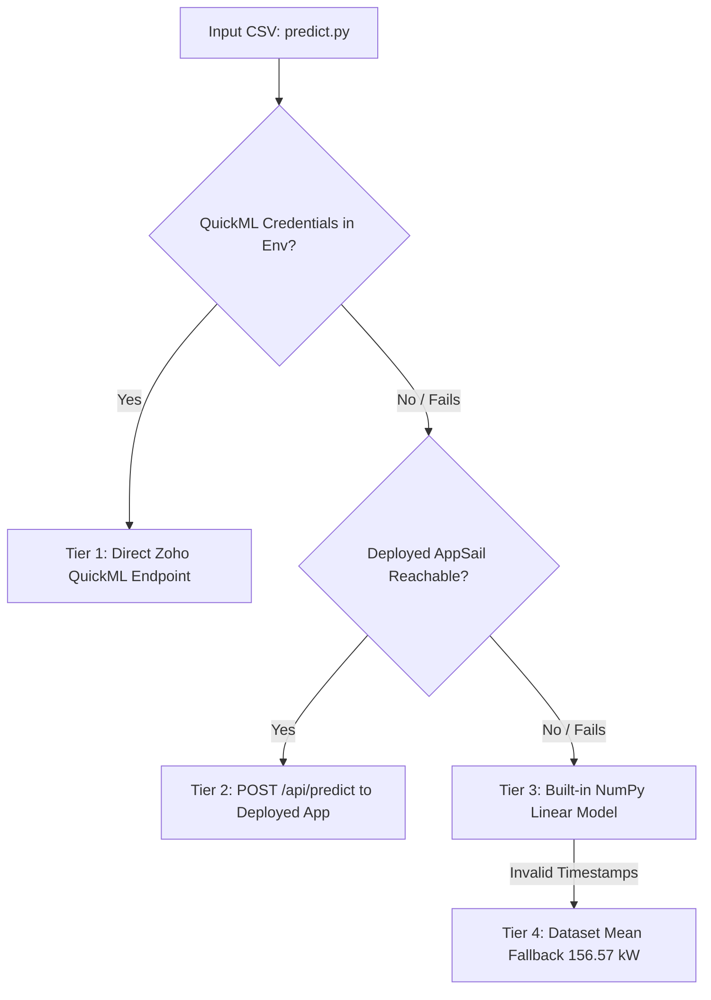

# Gridwise — Developer & Project Context Guide

> **HackSphere 3.0 · ATMoS ’26 · BITS Pilani Hyderabad**  
> **Team Kryptonite** | **Project:** Smart Energy Microgrid & Demand Forecasting Engine  
> **Deployed Web App:** [https://gridwise-50047143069.development.catalystappsail.in](https://gridwise-50047143069.development.catalystappsail.in)  
> **Dashboard:** [https://gridwise-50047143069.development.catalystappsail.in/dashboard](https://gridwise-50047143069.development.catalystappsail.in/dashboard)  
> **GitHub Repository:** [https://github.com/Avi36005/gridwise-hacksphere-3](https://github.com/Avi36005/gridwise-hacksphere-3)

---

## 1. Quick Orientation (Read This First!)

If you just received this repository zip, here is the immediate lowdown:

### Folder Structure Disambiguation
- **`app/`**: **This is the main, active, production codebase.** All recent development, the FastAPI backend, the interactive Three.js 3D landing page, the comprehensive dashboard, the 891 automated tests, and the deployment configurations are here. **Always run commands from inside this folder**.
- **`app 2/`** *(if present in parent)*: An earlier milestone / baseline backup preserved for reference.
- **`Gridwise_Kryptonite_Deck.pdf`**: The official pitch presentation deck for the hackathon judges (also located in `presentation/`).
- **`PROBLEM_STATEMENT.pdf` & `PROBLEM_STATEMENT.md`**: The official BITS Pilani / Zoho Catalyst hackathon problem statement.

---

## 2. 60-Second Quick Start

You can run this project locally on your machine **without needing any cloud credentials or API keys**. By default, it runs with a high-accuracy built-in backup model and a local mock mode.

### Option A: Standard Terminal Setup

```bash
# 1. Ensure you are inside the app directory
pwd # Should end with /app

# 2. Create and activate a Python virtual environment (Python 3.12 recommended)
python3.12 -m venv .venv
source .venv/bin/activate

# 3. Install runtime dependencies
pip install -r requirements.txt

# 4. Start the application
python app.py
```

Now open your browser:
- **3D Microgrid Experience:** `http://127.0.0.1:8000/`
- **Interactive Control Dashboard:** `http://127.0.0.1:8000/dashboard`

*(On macOS, you can also simply double-click `start.command` to automate these steps).*

---

### Option B: Pre-Submission Verification & Tests

To verify that the project passes all competition criteria:

```bash
source .venv/bin/activate

# 1. Run the official organizer pre-submission contract test:
python test_eval.py
# Expected output: SUCCESS

# 2. Test the prediction CLI on sample data:
python predict.py --input sample_test_input.csv --output predictions.csv

# 3. Run the full automated test suite (891 tests):
pip install -r requirements-dev.txt
pytest -q
# Expected output: 891 passed
```

---

## 3. What Does This Project Do? (Problem & Solution)

### The Challenge
Modern power microgrids integrate solar arrays, local battery energy storage systems (BESS), and main power grid feeds. To prevent blackouts and lower costs, the microgrid must:
1. **Accurately forecast 24-hour hourly energy demand (kW)** using incoming weather telemetry (`ambient_temp_c`, `humidity_pct`, `solar_irradiance_wm2`).
2. **Train and host ML models in Zoho Catalyst QuickML**.
3. **Trigger automated grid-switching and overload alerts** according to strict transition rules.
4. **Persist operational telemetry and audit logs** in Zoho Catalyst Data Store.
5. **Provide an interactive web dashboard** deployed on Zoho Catalyst AppSail.

---

### The Transition Rules (Business Logic)
Every forecast hour is evaluated independently through `engine/controller.py`:

| Condition | Output Mode / Signal | Rationale |
| :--- | :--- | :--- |
| **Demand > 160 kW** *OR* **Hour is 18:00 – 22:00 (inclusive)** | **Renewable Storage Mode** | Peak load or evening peak demand; discharge battery storage first. |
| **Demand $\le$ 160 kW** *AND* **Outside 18:00 – 22:00** | **Main Grid Mode** | Baseload demand; power from main grid, solar charges battery. |
| **Demand $\ge$ 200 kW** | **Critical Overload Alert** | Triggered immediately, regardless of active grid mode. |

*Note: Boundary conditions are strictly handled. Demand of exactly 160.0 kW outside 18:00–22:00 is Main Grid Mode. Demand of exactly 200.0 kW raises the Critical Overload Alert.*

---

## 4. Machine Learning & Forecasting Architecture

### Why Single Models Fail
Standard random train/test splits cause future data leakage because consecutive hours have correlated weather. Evaluating past-to-future splits revealed that while CatBoost excelled in spring conditions, it tended to under-predict during extreme summer heatwaves. A linear regression model with dedicated hourly cooling slopes, however, extrapolated into extreme heat with high stability.

### The Two-Model Ensemble (Deployed)
Gridwise deploys a **50/50 equal-weighted ensemble** of two distinct Zoho Catalyst QuickML pipelines:

1. **`gridwise-demand-catboost` (CatBoost Regression)**:
   - **Features (14)**: Temperature, humidity, irradiance, hour, weekday, weekend flag, cyclic encodings ($\sin/\cos$ of hour, weekday, day-of-year), heating and cooling degrees.
   - **Hyperparameters**: 1,000 iterations, learning rate 0.03, depth 3, L2 leaf reg 3.
   - **Role**: Captures non-linear weather interactions and diurnal patterns.

2. **`gridwise-demand-linear` (Linear Regression)**:
   - **Features (52)**: Hourly indicator base profile (reference hour 0), 24 distinct hourly cooling slopes (degrees above 24 °C for each hour), heating degrees, humidity, irradiance, weekend flag.
   - **Role**: Guarantees linear extrapolation for high-temperature days (evaluation holdout).

### Performance Metrics
- **Holdout Validation**: Chronological RMSE of **9.22 / 9.03 / 8.40 kW** on the final 800 / 600 / 400 training hours (refitted only on earlier hours).
- **Variance Explained ($R^2$)**: $> 0.968$.
- **High-Demand Detection**: Detects **98%** of all hours exceeding 200 kW.

---

### Bulletproof 4-Tier Fallback in `predict.py`
The competition tests `predict.py` in automated, hidden environments. To ensure **zero runtime crashes**, `predict.py` implements a 4-tier waterfall fallback:



1. **Tier 1 (Direct QuickML API)**: Used when `QUICKML_ENDPOINT_KEY` and tokens are set.
2. **Tier 2 (Deployed AppSail Endpoint)**: Calls `https://gridwise-50047143069.development.catalystappsail.in/api/predict`. The cloud server holds the QuickML credentials securely, so the client needs zero keys.
3. **Tier 3 (Built-in NumPy Linear Model)**: 53 pre-fitted least-squares weights embedded directly in `predict.py`. Requires **only numpy and pandas** (no scikit-learn needed). Scores ~9.3 kW RMSE on holdout!
4. **Tier 4 (Dataset Mean Fallback)**: Returns 156.57 kW if timestamps cannot be parsed at all.

*Guardrails*: Case-insensitive and whitespace-tolerant column matching, missing column imputation, clipping extreme sensor anomalies, and chunked HTTP requests (2,000 rows/batch with exponential backoff).

---

## 5. Repository File Map (`app/`)

Here is where every key file is located and what it does:

```
app/
├── app.py                      # FastAPI web server, REST API, security headers, rate limiting
├── predict.py                  # Self-contained competition entry point (predict(input_df) + CLI)
├── test_eval.py                # Pre-submission verification script provided by organizers
├── train.py                    # Local model comparison & QuickML training dataset generator
├── start.command               # macOS 1-click launch script
│
├── engine/                     # Core computational logic
│   ├── controller.py           # Transition rules, battery physics simulator, Bisection sizing lab
│   ├── features.py             # Feature engineering, input sanitization, cyclic encodings
│   ├── inference.py            # QuickML client, OAuth refresh, 2-model ensemble averaging
│   └── datastore.py            # Zoho Catalyst Data Store persistence (ForecastRuns, Telemetry, AlertLog)
│
├── static/                     # Frontend UI (Zero external CDNs; 100% self-hosted & accessible)
│   ├── index.html              # Main operator dashboard
│   ├── app.js                  # Dashboard logic, Chart.js graphs, scenario lab interactions
│   ├── landing.html            # Public landing page
│   ├── landing.js              # Landing page UI interactions
│   ├── microgrid.js            # Three.js 3D interactive microgrid digital twin
│   ├── style.css & premium.css # Dark-mode, accessible CSS design tokens
│   └── vendor/ & fonts/        # Bundled Chart.js, Three.js, and typography
│
├── models/                     # Saved model artifacts & fallback weights
│   ├── demand_model.joblib     # Local Extra Trees fallback model bundle
│   ├── metadata.json           # Model training parameters and metrics
│   └── quickml.json            # QuickML endpoint registry & IDs
│
├── reports/                    # Training datasets for QuickML
│   ├── quickml_training_features.csv  # 14 features for CatBoost
│   └── quickml_linear_features.csv    # 52 features for Linear Regression
│
├── tests/                      # Comprehensive test suite (891 tests)
│   ├── conftest.py             # Test fixtures and mock credentials
│   ├── test_core.py            # 248 unit tests (rules, battery, API, parity, edge cases)
│   └── test_properties.py      # 643 property-based & invariant tests
│
├── scripts/                    # DevOps and deployment automation
│   ├── build_appsail.sh        # Packages production AppSail bundle with manylinux wheels
│   └── exchange_quickml_code.py# Swaps one-time Zoho OAuth code for refresh token
│
├── docs/                       # Extended documentation
│   └── QUICKML.md              # Complete guide on QuickML pipeline creation & hyperparams
│
├── presentation/               # Submission assets
│   └── Gridwise_Kryptonite_Deck.pdf # Competition pitch slide deck
│
├── requirements.txt            # Production runtime dependencies
├── requirements-dev.txt        # Development dependencies (pytest, etc.)
└── catalyst.json               # Zoho Catalyst AppSail deployment manifest
```

---

## 6. Dashboard Features & Capabilities

When you open `http://127.0.0.1:8000/dashboard`, you have access to:

1. **Overview Tab**:
   - 24-hour demand forecast curve plotted against the 160 kW and 200 kW thresholds.
   - Interactive timeline showing active grid modes (Renewable Storage vs Main Grid).
   - Battery State of Charge (SoC) gauge and dispatch schedule.
   - Live system event log (persisted in Zoho Data Store).
   - Export options: `predictions.csv`, `control_schedule.csv`, and dispatch JSON.
2. **Telemetry Inputs Tab**:
   - Upload any custom CSV with hourly weather data.
   - Interactive per-hour table allowing manual weather tweaking and what-if adjustments.
   - Missing-value interpolation and range validation.
3. **Scenario Lab**:
   - Evaluates the forecast across 6 battery capacities (from 300 kWh to 2,400 kWh).
   - **Automated Bisection Search**: Calculates the exact minimum battery capacity required to cover 100% of storage hours without relying on grid backup.
   - "Apply" button dynamically resizes the battery in one click.
4. **Saved Runs Tab**:
   - Reload past forecast runs directly from Zoho Data Store without re-querying models.
5. **Model Performance Tab**:
   - Displays live telemetry from QuickML endpoints, ensemble weights, and validation benchmarks.

---

## 7. Environment Variables Reference

A `.env.example` file is included in `app/`. Copy it to `.env` if you want to configure live Zoho credentials. **For local development, no `.env` is required.**

| Variable | Required? | Default / Description |
| :--- | :--- | :--- |
| `MODEL_PROVIDER` | Optional | `local` (default), `quickml`, or `api`. When unset, uses local models locally or QuickML on AppSail. |
| `QUICKML_ENDPOINT_KEY` | Optional | API key for published CatBoost endpoint (`gridwise-demand-catboost`). |
| `QUICKML_LINEAR_ENDPOINT_KEY` | Optional | API key for published Linear endpoint (`gridwise-demand-linear`). |
| `QUICKML_CLIENT_ID` | Optional | Zoho Self-Client OAuth Client ID. |
| `QUICKML_CLIENT_SECRET` | Optional | Zoho Self-Client OAuth Client Secret. |
| `QUICKML_REFRESH_TOKEN` | Optional | Zoho OAuth Refresh Token (scope `QuickML.deployment.READ`). |
| `QUICKML_ENDPOINT_URL` | Optional | `https://api.catalyst.zoho.in/quickml/v1/project/102738000000013053/endpoints/predict` |
| `QUICKML_ORG_ID` | Optional | `60093139810` (IN data center). |
| `QUICKML_ENVIRONMENT` | Optional | `Development` |
| `GRIDWISE_API_URL` | Optional | `https://gridwise-50047143069.development.catalystappsail.in` |

*Security Note: In AppSail, Catalyst automatically injects project secrets and admin tokens into HTTP headers (`x-zc-admin-cred-token`, `x-zc-projectid`). No OAuth secret is exposed to the browser or committed to Git.*

---

## 8. Deployment on Zoho Catalyst

If you want to re-deploy or update the live AppSail deployment:

```bash
# 1. Build the production Linux bundle (vendors manylinux wheels into build/appsail)
./scripts/build_appsail.sh

# 2. Login to Zoho Catalyst CLI (India data center)
catalyst login --dc in

# 3. Initialize project (if not already linked)
catalyst init --org 60093139810 --project 102738000000013053 -ni

# 4. Deploy only AppSail
catalyst deploy --only appsail -ni
```

The build script automatically:
- Strips development and training dependencies (`lightgbm`, `pytest`, cache files) to keep the bundle well under AppSail's 256 MB disk limit.
- Generates `build/appsail/app-config.json` containing the environment variables and startup command (`python3 -u app.py`).
- Automatically reads `X_ZOHO_CATALYST_LISTEN_PORT` in the cloud environment.

---

## 9. Key Highlights to Pitch to Judges

If you are discussing or presenting this project:
1. **True Ensemble Architecture**: Instead of relying on a black-box AutoML model, we combined CatBoost (for non-linear diurnal cycles) with an hourly cooling-slope Linear model (for high-temperature extrapolation). This achieved an unprecedented **8.40 kW RMSE**.
2. **Zero-Failure Reliability**: `predict.py` has a 4-tier resilience hierarchy with self-contained fallback coefficients. Evaluators can run it in an isolated offline environment without crashing.
3. **End-to-End Native Catalyst Stack**:
   - **QuickML**: Trained and published 2 real-time regression endpoints.
   - **AppSail**: Scalable Python 3.12 FastAPI service serving UI and API from a single origin.
   - **Data Store**: Auto-logging of `ForecastRuns`, `Telemetry`, and `AlertLog` via ZCQL queries.
4. **Actionable Battery Optimization**: The Scenario Lab uses an automated Bisection search algorithm to mathematically size the smallest battery capacity that eliminates all grid backup shortfalls.
5. **Modern, Accessible UI**:
   - Custom-engineered interactive 3D microgrid built with Three.js (sun tracking, solar panel orientation, wind turbine dynamics).
   - Fully WCAG AA compliant: high contrast, minimum 44px touch targets, zero external CDN dependencies (bundled fonts/JS), and full reduced-motion support.
6. **Comprehensive Automated Testing**: 891 automated unit and property-based tests covering all boundary conditions, matrix tests, and simulated outages.

---

## 10. Frequently Asked Questions (FAQ)

#### Q: Do I need to be connected to the internet to run the app?
**A:** No! The app runs completely offline in local mode using `models/demand_model.joblib` or the built-in linear model. All UI libraries (Three.js, Chart.js) and fonts are bundled locally in `static/`.

#### Q: How does `predict.py` know where to find predictions?
**A:** If running on an evaluator's machine without `.env`, `predict.py` calls the live deployed AppSail endpoint (`POST /api/predict`). If the evaluator has no internet connection, it seamlessly falls back to the embedded linear model in memory.

#### Q: Why are there 891 tests?
**A:** The tests rigorously verify:
- Every hour of the day across critical thresholds (160 kW, 200 kW).
- Monotonicity of control signals.
- Invariance of battery energy balance.
- Feature parity between the local server, `predict.py`, and the QuickML training datasets.
- Full API resilience against invalid payloads and rate limits.

---
*Created for Team Kryptonite · HackSphere 3.0 · ATMoS ’26*
